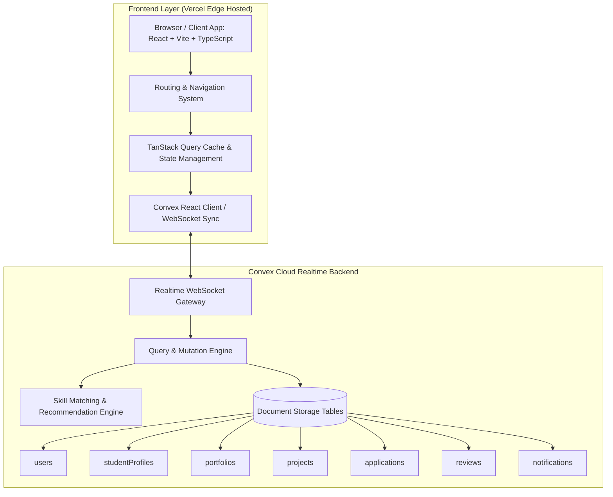
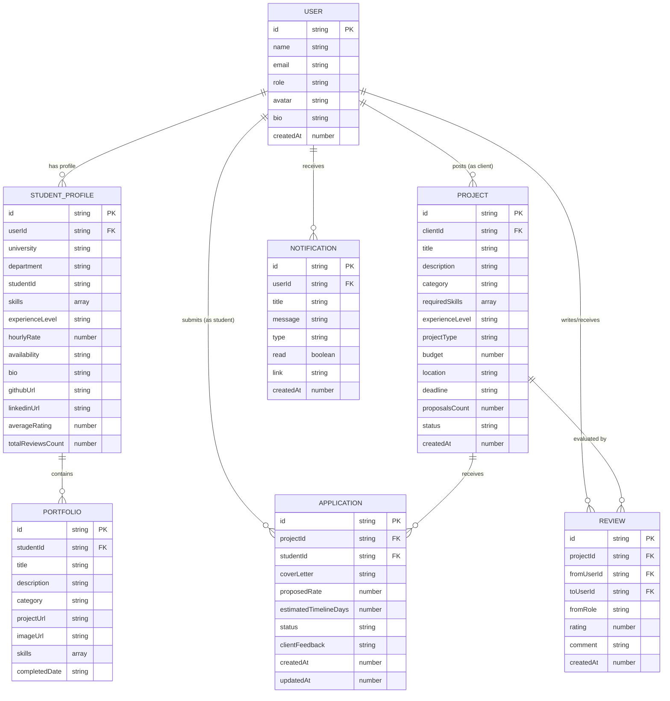
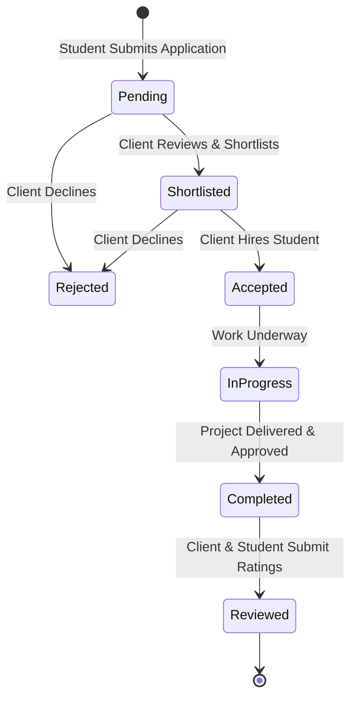

# System Design & Architecture Document
## Course: SE331 - Software Engineering Design Capstone Project
### Assessment 2: Student Freelance & Project Marketplace ("SkillBridge DIU / Prilans")

---

### 1. Executive Summary & Team Division

| Role | Member Responsibilities | Deliverables |
| :--- | :--- | :--- |
| **Member 1** | **Core System Design & Backend Design** | System Architecture, ERD, Schema Definition, Convex Backend Functions, Matching Algorithms, Seed Data |
| **Member 2** | **Basic Project Structure & Infrastructure** | Scaffolding (Vite + React + TS), TanStack Query / Routing, Context & Role Switcher, Base Layout & Components, Vercel Config |
| **Member 3** | **Frontend Engineering & User Experience** | UI Matching Mock Screenshot, Browse & Filter Pages, Application Flow, Portfolio Manager, Rating UI, Admin Dashboard |

---

### 2. High-Level System Architecture

The platform connects university students with small businesses and individuals seeking technical and creative services. The architecture utilizes a modern reactive Jamstack pattern:

---

### 3. Entity Relationship Diagram (ERD)

---

### 4. Skill Matching & Recommendation Engine Formulation

The platform features two distinct algorithmic matching mechanisms:

#### A. Skill-Based Project Recommendations (For Students)
Recommends projects to students based on skill alignment:
$$\text{MatchScore}_{\text{proj}}(S, P) = \left( \frac{|Skills_S \cap Skills_P|}{|Skills_P|} \times 0.70 \right) + \left( \text{ExpMatch}(E_S, E_P) \times 0.30 \right)$$
- If required skills overlap $\ge 40\%$, the project is flagged as a "Recommended Match".

#### B. Bonus Challenge: Talent Matcher (Student Recommendations for Projects)
Ranks students suitable for a specific project request:
$$\text{CandidateScore}(P, S) = w_1 \cdot \text{SkillOverlap} + w_2 \cdot \text{RatingFactor} + w_3 \cdot \text{ExpFactor} + w_4 \cdot \text{PortfolioRelevance}$$
Where:
- $w_1 = 0.50$ (Direct skill intersection)
- $w_2 = 0.25$ (Normalized student rating / 5.0)
- $w_3 = 0.15$ (Experience level parity)
- $w_4 = 0.10$ (Presence of verified portfolio items matching the project category)

---

### 5. Application Lifecycle State Machine

---

### 6. Backend API & Convex Functions Catalog

- `users.ts`: `getCurrentUser`, `listUsers`, `switchRole`, `createUser`
- `studentProfiles.ts`: `getProfile`, `upsertProfile`, `listTopStudents`, `getStudentById`
- `portfolios.ts`: `listPortfolios`, `addPortfolio`, `deletePortfolio`, `updatePortfolio`
- `projects.ts`: `listProjects`, `getProjectById`, `createProject`, `updateProjectStatus`, `listClientProjects`
- `applications.ts`: `applyForProject`, `getStudentApplications`, `getProjectApplications`, `updateApplicationStatus`
- `reviews.ts`: `submitReview`, `getUserReviews`, `getProjectReview`
- `matching.ts`: `getRecommendedProjectsForStudent`, `getRecommendedStudentsForProject` (Bonus Challenge)
- `admin.ts`: `getPlatformStats`, `getAdminOverview`, `moderateProject`, `moderateUser`
- `seed.ts`: Realistic initial dataset for DIU student profiles, demo jobs, and portfolios
